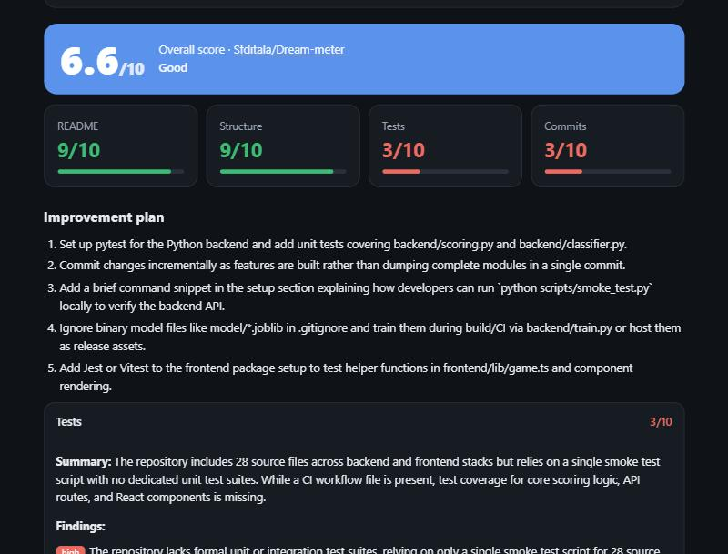
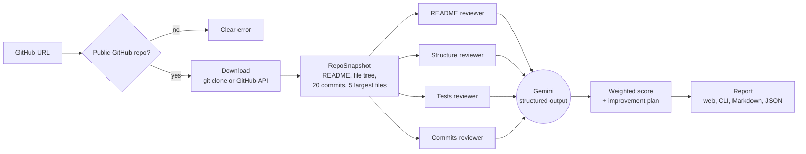

<p align="center"></p>

<p align="center">
  <a href="https://repolens-taupe-nu.vercel.app"></a>
</p>

> **Live demo · runs on Gemini's free tier, so an analysis takes 1–3 minutes.**

Paste a public GitHub repo. RepoLens reads it the way a recruiter or hiring manager does in their first two minutes: the README, the project structure, the tests and the commit history. It returns a score out of 10, findings that each cite evidence from the repo, and a five-step improvement plan.

<p align="center"><a href="https://repolens-taupe-nu.vercel.app"></a></p>

## What does it catch?

Pick a situation to see what RepoLens says about it. These come from real runs.

| Situation | Outcome |
|---|---|
| A repo with no README | **README 0/10.** The finding names the missing file and lists what a recruiter looks for: what it does, how to run it, screenshots. |
| The whole project in one commit | **Commits 2–3/10.** "Bundling whole systems into two commits hides your problem-solving process from hiring managers." |
| One smoke test for 28 source files | **Tests 3/10.** It names the untested modules, such as `backend/scoring.py`, and suggests pytest and Vitest. |
| A mature library with tests and CI | **8.5/10** for `pallets/itsdangerous`, against **1.7/10** for `octocat/Hello-World`. |
| The model cites a file | **Checked.** An accuracy script confirms every cited file really exists in the repo. |
| Gemini is overloaded or out of quota | **Falls back.** It switches to a lighter model, and if one area still fails, you get a partial report that names it. |

[▶ Try it on your own repo](https://repolens-taupe-nu.vercel.app)

## How it works



The four reviewers run at the same time with `asyncio.gather`. Each one returns a validated Pydantic object, not free text, so a score of 15 or a missing field is rejected before it reaches the report.

## The problem

Recruiters spend about two minutes on a candidate's GitHub. They don't run the code. They read the README, glance at the folders and scroll the commits. Most junior repos lose points there, and nobody tells their owner why.

## How it was built

**Stack:** Python · LangChain · Gemini (or Claude) · Pydantic · FastAPI · Vercel · GitHub API · pytest · GitHub Actions

<details open>
<summary><b>Design decisions</b></summary>

- **It reads a sample, not the whole codebase.** README, file tree, the last 20 commits and the 5 largest source files. No RAG and no embeddings, so one analysis costs 4 model calls.
- **Every finding needs evidence.** The schema has an `evidence` field, and the prompt forbids inventing files. Repo content is wrapped in tags and treated as data, not instructions.
- **Code decides what must be exact.** URL validation, the weighted score and the order of the plan are computed in code. The model only judges and writes.
- **One reviewer per area.** Four small, focused prompts score more consistently than one prompt that judges everything.
- **The model is swappable.** Only `llm.py` knows the provider. Set `GOOGLE_API_KEY` for Gemini or `ANTHROPIC_API_KEY` for Claude.

</details>

<details>
<summary><b>What broke, and the fix</b></summary>

| What went wrong | The fix |
|---|---|
| Four reviewers at once hit Gemini's free tier limit of 5 requests a minute, so every call returned 429. | A LangChain rate limiter spaces the calls, set from `REPOLENS_REQUESTS_PER_MINUTE`. |
| Gemini returned 503 "high demand" and one area failed, which failed the whole report. | A fallback model through `with_fallbacks`, and a partial report that names the missing area. |
| Vercel has no `git`, so cloning failed on the server. | Without git, the repo is downloaded as a tarball through the GitHub API. |
| A rewrite rule sent every request to `/api/index`, so every route returned 404. | Removed the rewrite. Vercel now routes requests straight to the FastAPI app. |
| LangChain's default structured output forces a tool call, which Claude Opus 5.5 rejects with a 400. | `method="json_schema"`, the provider's native structured output. |

</details>

<details>
<summary><b>Python concepts, and where they live</b></summary>

| Concept | File |
|---|---|
| Context manager (temp download, always cleaned up) | [`repolens/core/repo_loader.py`](repolens/core/repo_loader.py), [`github_api.py`](repolens/core/github_api.py) |
| Generators (walk files one at a time) | [`repolens/core/readers.py`](repolens/core/readers.py) |
| Decorators (`@retry`, `@timed`) | [`repolens/core/decorators.py`](repolens/core/decorators.py) |
| Abstract base class and inheritance | [`repolens/evaluators/`](repolens/evaluators/base.py) |
| `async` and `asyncio.gather` | [`repolens/pipeline.py`](repolens/pipeline.py) |
| LangChain and Pydantic structured output | [`repolens/llm.py`](repolens/llm.py), [`repolens/models.py`](repolens/models.py) |

</details>

## Is it accurate?

[`scripts/accuracy_check.py`](scripts/accuracy_check.py) runs the real pipeline on known repos.

| Check | Result |
|---|---|
| A near-empty repo, `octocat/Hello-World` (expected 0–4) | **1.7** ✅ |
| A mature library, `pallets/itsdangerous` (expected 7–10) | **8.5** ✅ |
| Every cited file exists in the repo | **2/2** ✅ (small sample) |
| The same repo twice | **8.0 and 7.9** ✅ |

`pytest` runs 43 tests with a fake model, so they need no API key. They run on every push in GitHub Actions.

## Run it yourself

1. Clone the repo and install:
   ```bash
   python -m venv .venv
   .venv\Scripts\activate        # macOS/Linux: source .venv/bin/activate
   pip install -r requirements-dev.txt
   ```
2. Copy `.env.example` to `.env` and add a free [Google AI Studio key](https://aistudio.google.com/apikey) as `GOOGLE_API_KEY`.
3. Start the web app with `uvicorn api.index:app --reload` and open http://localhost:8000.
4. Or use the CLI: `python -m repolens <user>/<repo> --lang en`.
5. To deploy, import the repo in Vercel and add `GOOGLE_API_KEY` and `REPOLENS_REQUESTS_PER_MINUTE=5` as environment variables.

All settings are listed in [`.env.example`](.env.example). The key lives only in `.env` and Vercel's settings, never in the code.

## العربية

<div dir="rtl">

حط رابط أي ريبو عام على GitHub، وRepoLens بيقرأه متل ما بيقرأه الـ recruiter بأول دقيقتين: الـ README، بنية المشروع، الاختبارات، ورسائل الـ commits. وبيرجعلك درجة من 10، وملاحظات لكل وحدة دليل من الريبو، وخطة تحسين من خمس خطوات. التقرير بيطلع بالعربي أو بالإنجليزي.

شرح المعمارية بالتفصيل: [docs/README.ar.md](docs/README.ar.md)

</div>

---

<p align="center">Built by <a href="https://portfolio-mauve-seven-44.vercel.app/"><b>Tala Safadi</b></a>, AI Engineer · <a href="https://www.linkedin.com/in/talasfdi">LinkedIn</a><br>More systems: <a href="https://github.com/Sfditala/ai-marketing-team">AI Marketing Team</a> · <a href="https://github.com/Sfditala/clinic-ai-receptionist">Clinic AI Receptionist</a> · <a href="https://github.com/Sfditala/telegram-personal-assistant">Telegram Personal Assistant</a></p>
